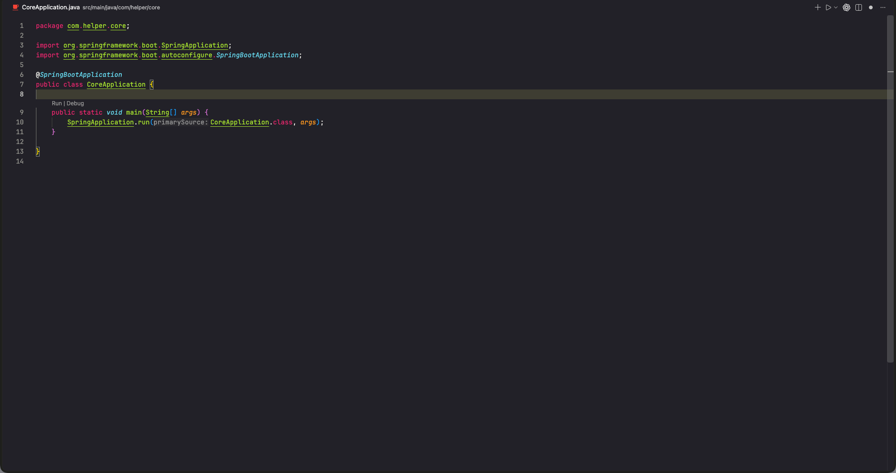

vimlarp vimlarp idc i like it this way

my daily main ide for backend & devops tasks

drop these into your vs code user config 

install the extensions with `xargs -n 1 code --install-extension < extensions.txt`

font is JetBrainsMono Nerd Font.

command+k+z zen mode